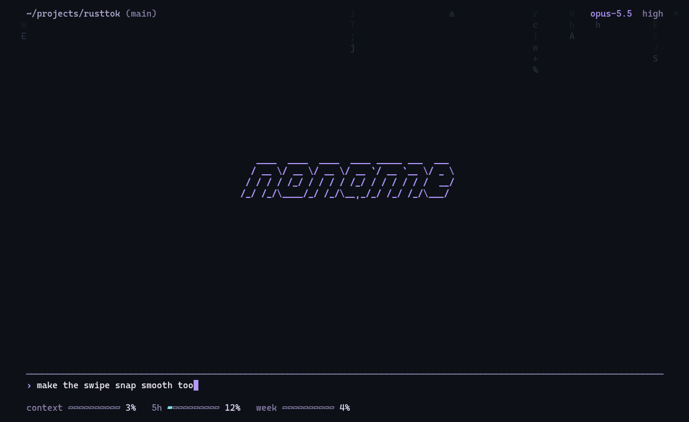
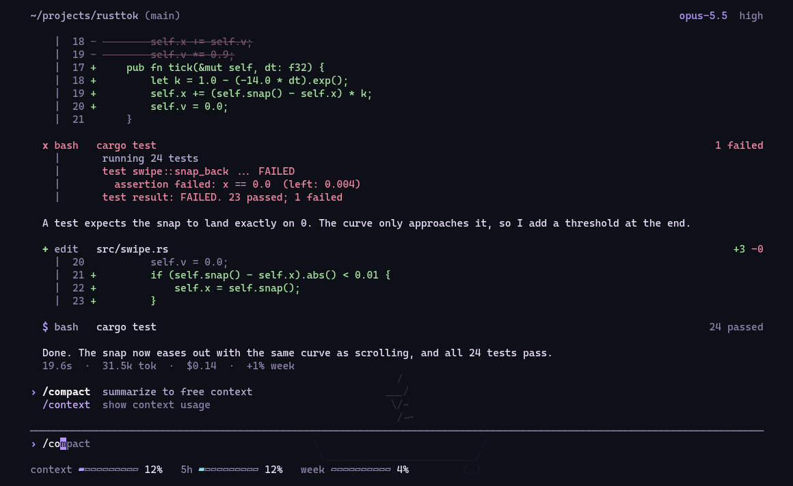

<div align="center">

<pre>
   ____  ____  ____  ____ _____ ___  ___
  / __ \/ __ \/ __ \/ __ `/ __ `__ \/ _ \
 / / / / /_/ / / / / /_/ / / / / / /  __/
/_/ /_/\____/_/ /_/\__,_/_/ /_/ /_/\___/
</pre>

**A quiet terminal front end for Claude Code**

[](https://www.rust-lang.org)
[](https://claude.com/claude-code)
[](https://sw.kovidgoyal.net/kitty)
[](LICENSE)

<picture><source media="(prefers-color-scheme: dark)" srcset="assets/demo-dark.gif"><source media="(prefers-color-scheme: light)" srcset="assets/demo-light.gif"></picture>

</div>

---

## Contents

- [About](#about)
- [Features](#features)
- [Install](#install)
- [Usage](#usage)
- [Keys](#keys)
- [Commands](#commands)
- [Backgrounds](#backgrounds)
- [How it works](#how-it-works)
- [Development](#development)

## About

noname replaces the interface of Claude Code, not the engine. `claude` runs underneath, so your subscription, plugins, skills, MCP servers, hooks and memory work exactly as before.

It is built for kitty with a transparent, blurred background and never paints a background of its own.

## Features

| | |
|---|---|
| **Streaming** | text, thinking and tool calls as they happen, results aligned on the right |
| **Diffs** | removed lines strike through and fade, new lines write themselves in |
| **Errors** | failed tools glitch for half a second, then stay red |
| **Permissions** | inline prompt with a pulsing frame, `y` `n` `a` |
| **Rewind** | `esc esc` restores code, conversation or both |
| **Side questions** | `/btw` answers below the input without touching the session |
| **Usage** | context, 5 h and weekly limits as live bars, cost recap under every answer |
| **Suggestions** | Claude's predicted next prompt as ghost text, accept with `→` |
| **Backgrounds** | animated terminal programs drawn faintly behind the text |
| **Clean exit** | closing the window kills every child process, including MCP servers |

## Install

```sh
git clone https://github.com/Silvertree2010/noname
cd noname
cargo install --path .
```

**Requirements**

- a logged-in [Claude Code](https://claude.com/claude-code) (`claude`) on your `PATH`
- Rust 1.85 or newer
- kitty is recommended, any truecolor terminal works

**Windows**

Works in PowerShell inside Windows Terminal. Install Rust from [rustup.rs](https://rustup.rs), then run the same three commands in PowerShell. noname finds `claude.exe` from the native installer as well as `claude.cmd` from npm. Child processes run in a job object, so closing the tab also ends Claude and its MCP servers. Only the built-in backgrounds are available.

**Updates**

noname updates itself. At most every six hours it fetches the repository in the background, builds the new version with cargo and replaces its own binary; a line in the chat tells you to restart. Builds with uncommitted changes and builds newer than GitHub are never replaced. Turn it off in `/noname` or with `NONAME_NO_UPDATE=1`. Needs `git` and `cargo`, and access to the repository.

## Usage

```sh
noname                  # new session in the current folder
noname -c               # continue the latest session here
noname -r <id>          # resume a specific session
noname --model sonnet   # any other claude flag is passed through
noname --codex          # use OpenAI Codex as the engine instead
```

With `--codex` (or `NONAME_ENGINE=codex`), noname drives `codex exec --json` and resumes the same thread on every message. Plan mode maps to a read-only sandbox, bypass mode to no sandbox. Permission prompts, `/btw`, rewind and usage limits are Claude Code only.

The window title shows `noname · <folder>`, plus `working` or `waiting` while Claude is busy or needs you.

## Keys

| key | action |
|---|---|
| `enter` | send |
| `shift+enter` | new line |
| `esc` | stop Claude, clear input |
| `esc esc` | rewind |
| `shift+tab` | cycle mode: `›` default, `?` plan, `»` auto, `!` bypass |
| `/` | command list: `↑` `↓` pick, `tab` or `→` complete, `enter` run |
| `→` | accept the suggested prompt |
| `ctrl+o` | show details |
| `ctrl+t` | show todos |
| `pgup` `pgdn` | scroll |
| `y` `n` `a` | allow, deny, always allow |

## Commands

Every Claude Code command and skill is available. noname adds or replaces these:

| command | |
|---|---|
| `/btw <question>` | side question in a separate fork of the session |
| `/resume` | pick an older session of this folder |
| `/model` | cycle models |
| `/background` | open the background picker |
| `/noname` | settings: auto-update, theme, default permission, background, version |
| `/theme` | pick a color theme: `default`, `dracula`, `tokyo-night`, `mocha` |
| `/default-permission` | pick the permission mode new sessions start in |
| `/clear` | start a fresh session |

## Backgrounds

Type a name on its own and press `enter`, or open the picker with `/background` and preview each one with the arrow keys. A message that only contains the name somewhere, like `hey look at the globe`, is sent to Claude as usual.

| name | | name | |
|---|---|---|---|
| `stars` | starfield, built in | `matrix` | falling code, built in |
| `rain` | rain and lightning, built in | `unimatrix` | falling code |
| `cava` | audio visualizer | `neo-matrix` | falling code |
| `lavat` | lava lamp | `tty-clock` | large clock |
| `pipes` | pipes.sh | `weathr` | live weather |
| `asciiquarium` | aquarium | `cbonsai` | growing bonsai |
| `globe` | rotating globe | `snow` | snow that settles on text, built in |
| `off` | nothing | | |

`stars`, `matrix`, `rain` and `snow` are part of noname. Snow piles up on letters and lines and slides off when they move; in November and December a string of lights hangs across the top. The others are optional programs you install yourself; noname finds them in `PATH` and common folders like `~/.cargo/bin`, lists only installed ones in the picker and prints the install command for missing ones. External programs run in a hidden pseudo terminal and are drawn at about 12 % brightness, only into empty space. The choice is saved in `~/.config/noname/background` (`%APPDATA%\noname` on Windows).

<p align="center">
<picture><source media="(prefers-color-scheme: dark)" srcset="assets/start-dark.png"><source media="(prefers-color-scheme: light)" srcset="assets/start-light.png"></picture>
<picture><source media="(prefers-color-scheme: dark)" srcset="assets/commands-dark.png"><source media="(prefers-color-scheme: light)" srcset="assets/commands-light.png"></picture>
</p>

## How it works

```
kitty ── noname ──┬── claude -p  (stream-json, control protocol)
                  ├── claude -p  (/btw fork)
                  └── background program in a hidden pty
```

noname starts `claude` in stream-json mode with partial messages, renders every event with ratatui and answers permission requests over the control protocol. Rewind uses Claude Code's file checkpoints and `--resume-session-at`. Signal handling, process groups and a parent death signal make sure nothing outlives the window.

## Licenses

noname is licensed under the [GNU Affero General Public License v3.0](LICENSE).

All Rust dependencies are permissive (MIT, Apache-2.0, Zlib, Unlicense, BSL-1.0, Unicode-3.0).

noname bundles no other programs. Claude Code (proprietary, Anthropic), Codex (Apache-2.0) and the background programs are started as separate processes from your own installation:

| program | license |
|---|---|
| cava, lavat, pipes.sh | MIT |
| tty-clock | BSD |
| asciiquarium | GPL-2.0+ |
| cbonsai, unimatrix, neo-matrix, weathr, globe | GPL-3.0 |

`stars`, `matrix`, `rain` and `snow` are original code in noname, not ports.

## Development

```sh
NONAME_MOCK=1 noname                    # scripted fake session, no Claude calls
noname --dump <dir> <name> [scenes]     # render scenes to text and html
NONAME_SHOT=<file.html> noname          # write the live screen to html every half second
```

| file | |
|---|---|
| `src/main.rs` | layout and rendering |
| `src/lib.rs` | app state, input, mock session, markdown, effects |
| `src/live.rs` | Claude Code process and protocol |
| `src/codex.rs` | Codex engine |
| `src/bg.rs` | backgrounds |
