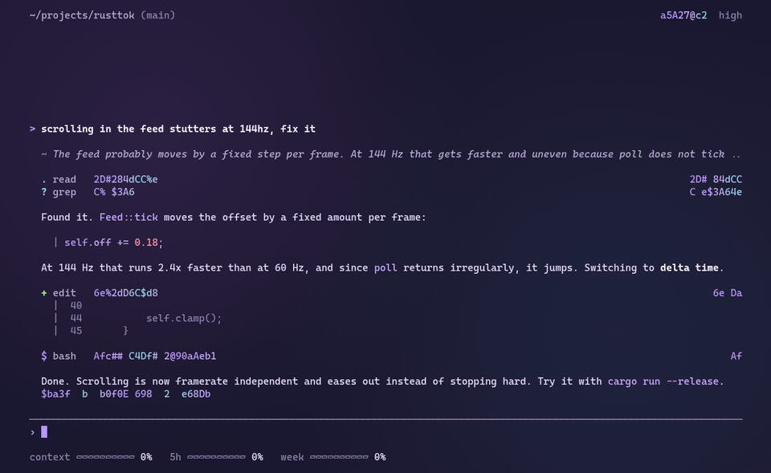
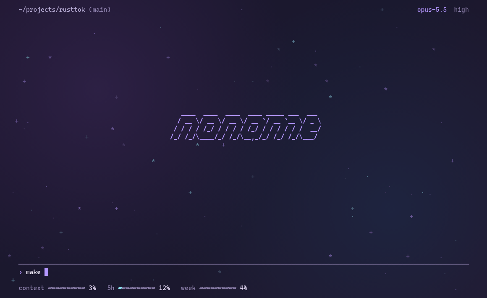
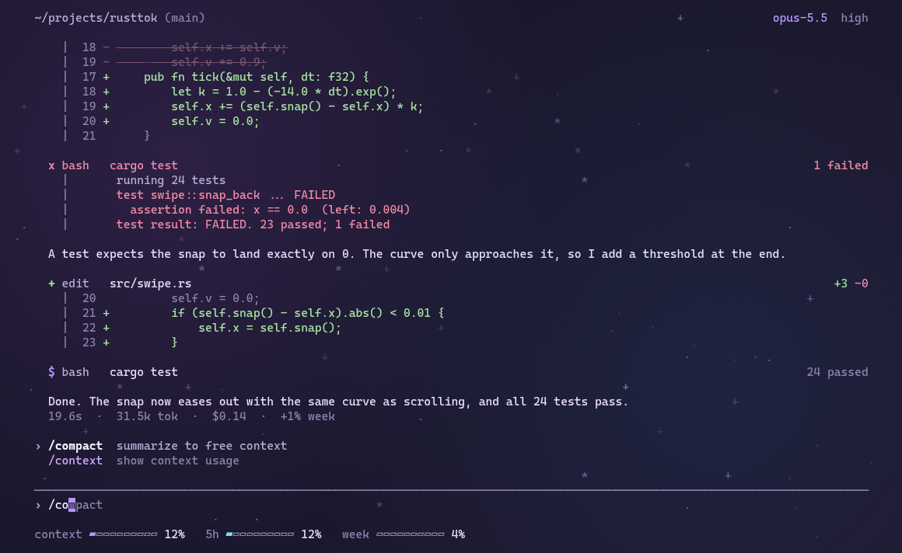

<div align="center">

<pre>
   ____  ____  ____  ____ _____ ___  ___
  / __ \/ __ \/ __ \/ __ `/ __ `__ \/ _ \
 / / / / /_/ / / / / /_/ / / / / / /  __/
/_/ /_/\____/_/ /_/\__,_/_/ /_/ /_/\___/
</pre>

**A quiet terminal front end for Claude Code**

[](https://www.rust-lang.org)
[](https://ratatui.rs)
[](https://claude.com/claude-code)
[](https://sw.kovidgoyal.net/kitty)
[](#)
[](#)



</div>

---

## Contents

- [About](#about)
- [Features](#features)
- [Install](#install)
- [Usage](#usage)
- [Keys](#keys)
- [Commands](#commands)
- [Backgrounds](#backgrounds)
- [How it works](#how-it-works)
- [Development](#development)

## About

noname replaces the interface of Claude Code, not the engine. `claude` runs underneath, so your subscription, plugins, skills, MCP servers, hooks and memory work exactly as before.

It is built for kitty with a transparent, blurred background and never paints a background of its own.

## Features

| | |
|---|---|
| **Streaming** | text, thinking and tool calls as they happen, results aligned on the right |
| **Diffs** | removed lines strike through and fade, new lines write themselves in |
| **Errors** | failed tools glitch for half a second, then stay red |
| **Permissions** | inline prompt with a pulsing frame, `y` `n` `a` |
| **Rewind** | `esc esc` restores code, conversation or both |
| **Side questions** | `/btw` answers below the input without touching the session |
| **Usage** | context, 5 h and weekly limits as live bars, cost recap under every answer |
| **Suggestions** | Claude's predicted next prompt as ghost text, accept with `→` |
| **Backgrounds** | animated terminal programs drawn faintly behind the text |
| **Clean exit** | closing the window kills every child process, including MCP servers |

## Install

```sh
git clone https://github.com/Silvertree2010/noname
cd noname
cargo install --path .
```

**Requirements**

- a logged-in [Claude Code](https://claude.com/claude-code) (`claude`) on your `PATH`
- Rust 1.85 or newer
- kitty is recommended, any truecolor terminal works

## Usage

```sh
noname                  # new session in the current folder
noname -c               # continue the latest session here
noname -r <id>          # resume a specific session
noname --model sonnet   # any other claude flag is passed through
```

The window title shows `noname · <folder>`, plus `working` or `waiting` while Claude is busy or needs you.

## Keys

| key | action |
|---|---|
| `enter` | send |
| `shift+enter` | new line |
| `esc` | stop Claude, clear input |
| `esc esc` | rewind |
| `shift+tab` | cycle mode: `›` default, `?` plan, `»` auto, `!` bypass |
| `/` | command list: `↑` `↓` pick, `tab` or `→` complete, `enter` run |
| `→` | accept the suggested prompt |
| `ctrl+o` | show details |
| `ctrl+t` | show todos |
| `pgup` `pgdn` | scroll |
| `y` `n` `a` | allow, deny, always allow |

## Commands

Every Claude Code command and skill is available. noname adds or replaces these:

| command | |
|---|---|
| `/btw <question>` | side question in a separate fork of the session |
| `/resume` | pick an older session of this folder |
| `/model` | cycle models |
| `/background` | open the background picker |
| `/clear` | start a fresh session |

## Backgrounds

Type a name on its own and press `enter`, or open the picker with `/background` and preview each one with the arrow keys. A message that only contains the name somewhere, like `hey look at the globe`, is sent to Claude as usual.

| name | | name | |
|---|---|---|---|
| `stars` | built in starfield | `cmatrix` | falling code |
| `cava` | audio visualizer | `unimatrix` | falling code |
| `lavat` | lava lamp | `neo-matrix` | falling code |
| `pipes` | pipes.sh | `tty-clock` | large clock |
| `asciiquarium` | aquarium | `weathr` | live weather |
| `cbonsai` | growing bonsai | `rain` | rain and lightning |
| `globe` | rotating globe | `off` | nothing |

External programs run in a hidden pseudo terminal and are drawn at about 12 % brightness, only into empty space. The choice is saved in `~/.config/noname/background`.

<p align="center">


</p>

## How it works

```
kitty ── noname ──┬── claude -p  (stream-json, control protocol)
                  ├── claude -p  (/btw fork)
                  └── background program in a hidden pty
```

noname starts `claude` in stream-json mode with partial messages, renders every event with ratatui and answers permission requests over the control protocol. Rewind uses Claude Code's file checkpoints and `--resume-session-at`. Signal handling, process groups and a parent death signal make sure nothing outlives the window.

## Development

```sh
NONAME_MOCK=1 noname                    # scripted fake session, no Claude calls
noname --dump <dir> <name> [scenes]     # render scenes to text and html
NONAME_SHOT=<file.html> noname          # write the live screen to html every half second
```

| file | |
|---|---|
| `src/main.rs` | layout and rendering |
| `src/lib.rs` | app state, input, mock session, markdown, effects |
| `src/live.rs` | Claude Code process and protocol |
| `src/bg.rs` | backgrounds |
