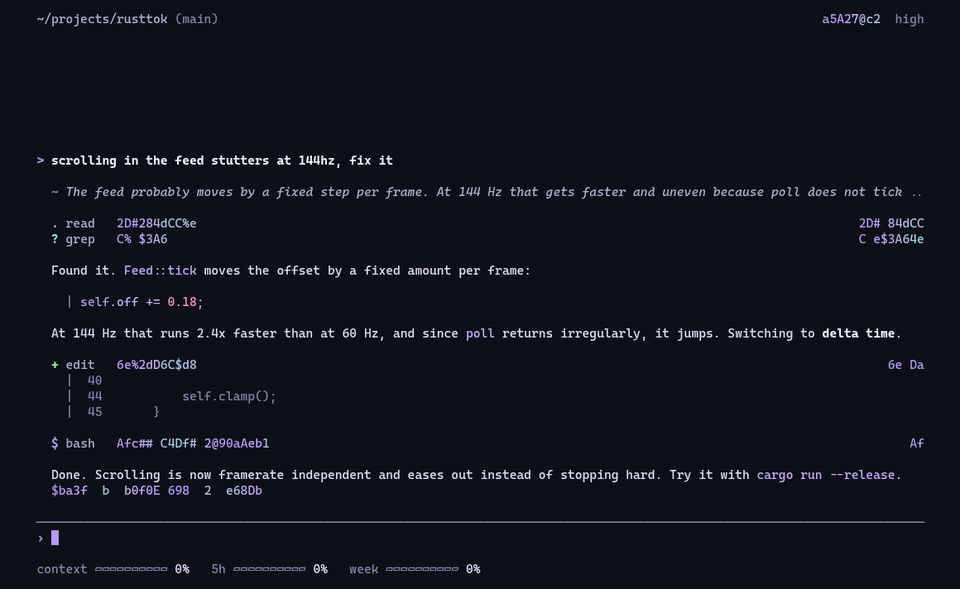

<div align="center">

<pre>
   ____  ____  ____  ____ _____ ___  ___
  / __ \/ __ \/ __ \/ __ `/ __ `__ \/ _ \
 / / / / /_/ / / / / /_/ / / / / / /  __/
/_/ /_/\____/_/ /_/\__,_/_/ /_/ /_/\___/
</pre>

**A quiet terminal front end for Claude Code**

[](https://www.rust-lang.org)
[](https://claude.com/claude-code)
[](https://sw.kovidgoyal.net/kitty)
[](LICENSE)

<picture><source media="(prefers-color-scheme: dark)" srcset="assets/demo-dark.gif"><source media="(prefers-color-scheme: light)" srcset="assets/demo-light.gif"></picture>

</div>

---

## About

noname replaces the interface of Claude Code, not the engine. `claude` runs underneath, so your subscription, plugins, skills, MCP servers and hooks keep working. Made for kitty with a transparent background, works in any truecolor terminal and in Windows Terminal.

- streaming text, thinking and tools, diffs that write themselves in
- inline permissions and questions, rewind with `esc esc`, `/btw` side questions
- live context and limit bars, cost under every answer
- themes, animated backgrounds, self updates

## Install

```sh
curl -fsSL https://github.com/Silvertree2010/noname/releases/latest/download/install.sh | sh
```
```powershell
irm https://github.com/Silvertree2010/noname/releases/latest/download/install.ps1 | iex
```

Also: Homebrew (`brew install Silvertree2010/noname/noname`), Scoop, `.deb` and `.rpm` from the [releases](https://github.com/Silvertree2010/noname/releases/latest), or `cargo install --git https://github.com/Silvertree2010/noname`. AUR is coming. Needs a logged-in [Claude Code](https://claude.com/claude-code).

## Usage

```sh
noname              # new session
noname -c           # continue the latest session
noname -r <id>      # resume a session
noname --codex      # use Codex as the engine
```

Other flags go straight to `claude`.

| key | | command | |
|---|---|---|---|
| `enter` | send | `/noname` | settings |
| `shift+enter` | new line | `/theme` | color theme |
| `esc` | stop | `/background` | animated background |
| `esc esc` | rewind | `/default-permission` | starting mode |
| `shift+tab` | cycle mode | `/resume` | older sessions |
| `ctrl+o` | details | `/btw` | side question |
| `→` | accept suggestion | `/model` | cycle models |

Every Claude Code command and skill works as usual.

## License

[AGPL-3.0](LICENSE). noname bundles nothing; Claude Code, Codex and the background programs run from your own installation.
